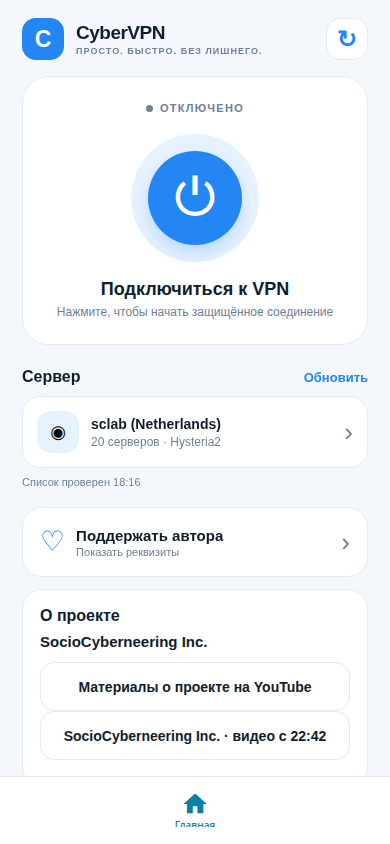
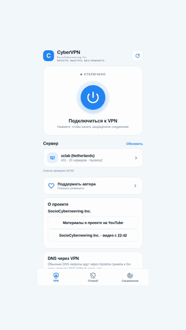

# CyberVPN for Android

CyberVPN is a Russian-language Android VPN client built with Expo/React Native and a native Android `VpnService`. It uses the Hysteria2 protocol and is intended to stay small and straightforward: choose a server, approve Android's VPN prompt, and connect.

<p align="center">
  
</p>
<p align="center"><strong>Simple controls · Hysteria2 · configurable DNS and routing</strong></p>
<p align="center">
  
</p>

> The image above is a mobile-sized interface preview, not a capture from an installed Android device. A successful APK build verifies packaging, but VPN routing should still be tested on the target device and network.

## Interface demo

[](docs/videos/cybervpn-ui-demo.mp4)

This short clip uses screenshots from the mobile Preview to show the VPN, Firewall, and Connections screens. It demonstrates interface layout only: VPN is disconnected in Preview, Firewall app blocking depends on Android Lockdown, and live connection monitoring requires the installed Android build.

## Download and install

1. Open the [latest GitHub Release](https://github.com/sociocyber1/CyberVPN-Android/releases/latest) and download **`CyberVPN.apk`**.
2. On the Android device, open the downloaded APK. If Android asks, allow the browser or file manager to install unknown apps, then retry the installer.
3. Open CyberVPN, choose a server, and tap **Подключиться к VPN** (Connect to VPN).
4. Accept Android's system VPN connection request. Android displays the active VPN key/status icon while the tunnel is running.

CyberVPN targets **Android 10 / API 29 or later**. The native Hysteria2 core is built for `arm64-v8a` and `armeabi-v7a`. This project distributes APKs through GitHub Releases; it is not currently listed in Google Play.

To upgrade, install the APK from the newer release over the existing copy. If Android reports a signature conflict, do not uninstall immediately if you need the app's local settings; contact the maintainer with the exact message. Release APKs must be signed consistently for in-place upgrades, so signing-key continuity is important for future builds.

## What the app does

### VPN connection and server configuration

- Connects through Android's native `VpnService`; the Go core is built from a pinned Hysteria2 source revision.
- Downloads `hy2://` server URIs from the configured [sociocyber1/txt README](https://github.com/sociocyber1/txt/blob/main/README.md) when the app starts and keeps a local cache for fallback when refreshing fails.
- Shows the connection state reported by the Android service rather than assuming a tap succeeded.
- Requests VPN consent through Android's system dialog; the user can disconnect from the app at any time except when Android lockdown policy requires an active always-on VPN.

### DNS settings

Choose custom DNS upstreams for requests sent through the tunnel: UDP, TCP, DNS-over-TLS (DoT), or DNS-over-HTTPS (DoH). The app supports up to eight configured upstream addresses. The selected DNS setup is saved locally and used by the native Go core after reconnection.

### NoToVPN domain and site exclusions

NoToVPN is **off by default**. When enabled, explicitly configured domain zones and site rules are resolved and routed directly over the device's physical network rather than through Hysteria. The initial suggestions include `.ru`, `.kz`, `.eu`, and a Russian public-sector site list; suggestions do not activate the feature by themselves. The optional country-code zone preset adds a broad list only after the user selects it.

Rules support exact host names and zone/subdomain matching. The total rule limit is 400. NoToVPN is DNS-aware IP routing, **not** a strict per-domain firewall: shared CDN addresses may temporarily affect other domains, and applications using their own encrypted DNS or cached IPs may bypass hostname-based decisions. Directly routed excluded traffic does not use the Hysteria tunnel.

### VPN Firewall and app exclusions

The Firewall screen lets the user select installed applications for blocking while CyberVPN is active. Android's per-app VPN include/exclude lists alone do not block the excluded app; real blocking requires Android **Always-on VPN** and **Block connections without VPN** (lockdown). Follow the in-app warning and enable these OS settings before relying on the firewall. If the tunnel stops while lockdown is active, Android may block non-VPN traffic by design.

A separate per-app **VPN exclusion** option sends selected applications over the ordinary device network instead of the VPN. That traffic exposes the normal network's public address to those applications and their services. It is not the same as firewall blocking.

### Live connections

The Connections screen displays newly observed TCP/UDP flows through the VPN's TUN interface, with destination IP/port, age, and an application label when Android can resolve the owning UID. It is a short-lived view (up to about 60 seconds), not a complete list of every socket or every packet on the device. Some flows have no attributable application. Blocking a flow's app requires the Android lockdown conditions above.

## Privacy and limitations

- Android and other apps may be able to detect that a VPN transport is active; CyberVPN does not hide the VPN from the operating system.
- Services reached through the tunnel can observe the VPN server's exit IP. Direct NoToVPN traffic and apps excluded from VPN use the ordinary network instead.
- The server configuration source and the selected DNS providers receive the requests needed to provide those services. Review their own policies if this matters for your use.
- DNS-derived routing can be imprecise for shared CDNs, encrypted DNS, and cached addresses. Do not treat it as a security boundary or a guarantee that every request for a domain uses one route.
- VPN operation depends on the selected server, network and Android device. A successful installation does not certify reachability from every country, ISP or mobile network.

## Release builds

The [Android release workflow](.github/workflows/android-release.yml) runs when a GitHub Release is published and can also be started manually. It generates the native Android project, builds the Hysteria2 Go AAR and release APK, and calculates a SHA-256 checksum. To build the selected branch without changing a release, run **Actions → Android release APK → Run workflow** and leave `tag_name` blank. To build the selected branch and replace the APK/checksum on an existing release, enter that release's tag (for example, `v1.0.3`); this does not publish a draft release.

CI requires a persistent Android PKCS#12 signing keystore. Configure these repository secrets under **Settings → Secrets and variables → Actions**: `CYBERVPN_RELEASE_KEYSTORE_BASE64` (base64-encoded `.p12` file), `CYBERVPN_RELEASE_KEYSTORE_PASSWORD`, `CYBERVPN_RELEASE_KEY_ALIAS`, and `CYBERVPN_RELEASE_KEY_PASSWORD`. The workflow decodes the keystore into the temporary runner directory and fails rather than silently signing with a debug key if any secret is missing. Never commit the keystore, its passwords, or its base64 data. A local build without the release environment variables continues to use the Android debug key and is not suitable for distribution or in-place updates.

## Build locally

A native build requires Node.js, pnpm 9.12.0, JDK 21, Android SDK/NDK, and a Go toolchain. The Gradle `preBuild` task runs `modules/cybervpn-vpn/android/build-hysteria-aar.sh`, which downloads the pinned Go toolchain and Hysteria source as needed and uses `gomobile` to create the native AAR. The Android module requires NDK side-by-side and `ANDROID_HOME` or `ANDROID_SDK_ROOT`.

```bash
pnpm install --frozen-lockfile
pnpm exec expo prebuild --platform android --no-install
cd android
./gradlew assembleRelease
```

The APK is written to `android/app/build/outputs/apk/release/app-release.apk`. A TypeScript check or web Preview does not replace a native Gradle build or a real-device VPN test.

## Repository layout

- `app/`, `components/`, `lib/` — Expo screens and application logic.
- `modules/cybervpn-vpn/` — Expo bridge, Android service, and Go/Hysteria2 core integration.
- `docs/` — Android integration notes, routing sources, and interface preview assets.
- `.github/workflows/android-release.yml` — release APK automation.

## License

CyberVPN is distributed under GPL-3.0. See [`LICENSE`](LICENSE) and [`THIRD_PARTY.md`](THIRD_PARTY.md) for license and third-party notices. The bundled Latin Modern Sans typeface has its own included GUST Font License in [`assets/fonts/GUST-FONT-LICENSE.txt`](assets/fonts/GUST-FONT-LICENSE.txt).
