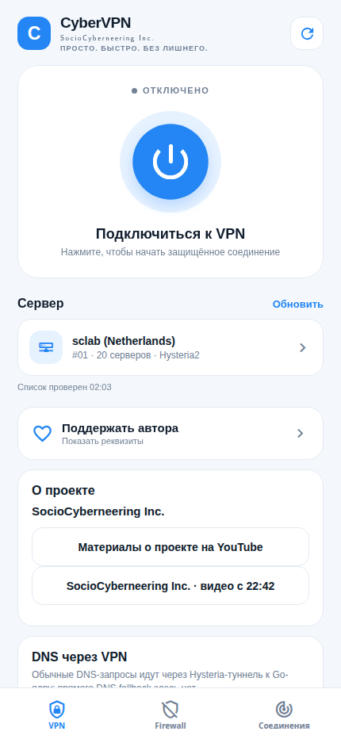
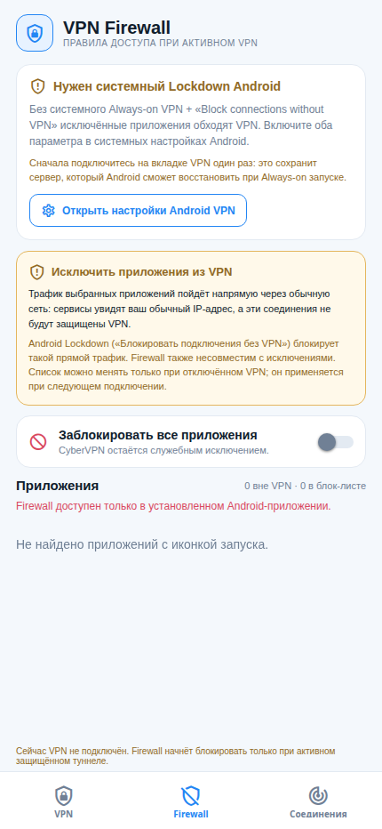
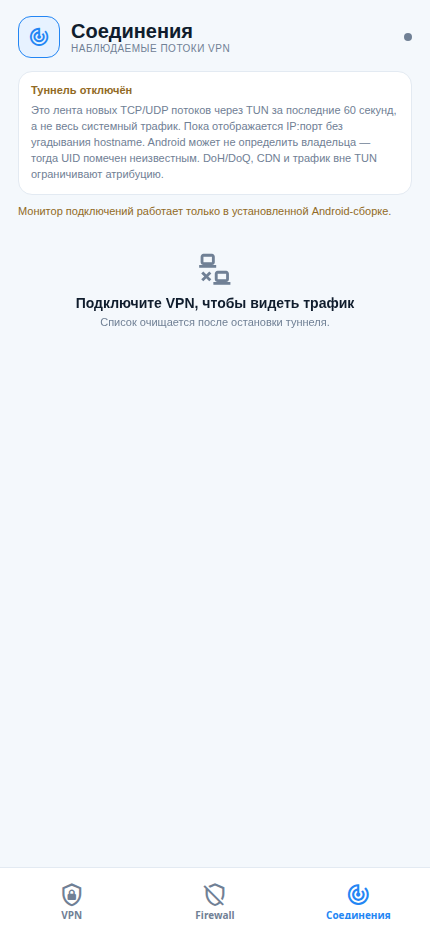

# CyberVPN interface demo — storyboard

**Purpose:** A concise, accurate README demo of the real CyberVPN interface. It is a Preview walk-through, not a fabricated recording of a connected Android tunnel.

**Format:** 720 × 1280 (portrait 9:16), 30 fps, 12 seconds, silent H.264 MP4. Pale blue background from the app palette. Preserve all screenshot pixels; fit the full 430 × 932 screens to the portrait frame without cropping, with small matching side margins. Use restrained 250 ms cross-dissolves and a very subtle scale settle; do not invent tap actions or a connected state.

| Time / reading hold | Screen and message | Reference |
| --- | --- | --- |
| 0.0–3.8 s | Home / VPN tab. Show the actual disconnected home screen, selected server row, support card, and bottom navigation. Message: one main connection action with the brand visible. |  |
| 3.8–7.6 s | VPN Firewall tab. Show the Android Lockdown warning and the current empty-app-list state. Message: true app blocking depends on Android Always-on VPN plus Block connections without VPN. |  |
| 7.6–11.4 s | Connections tab. Show the current disconnected state and the explanatory description of observed TCP/UDP flows. Message: this is a short-lived TUN-flow view, not a complete system traffic log. |  |
| 11.4–12.0 s | Hold the Connections screen, then fade to the app's pale-blue background. | — |

**Accuracy note:** The screenshots come from the mobile Web Preview at 430 × 932. The Firewall list is empty and Connections reports that a native Android build is required for live monitoring. The video must retain those real states and disclose that it demonstrates interface layout only, not a confirmed active VPN connection.
